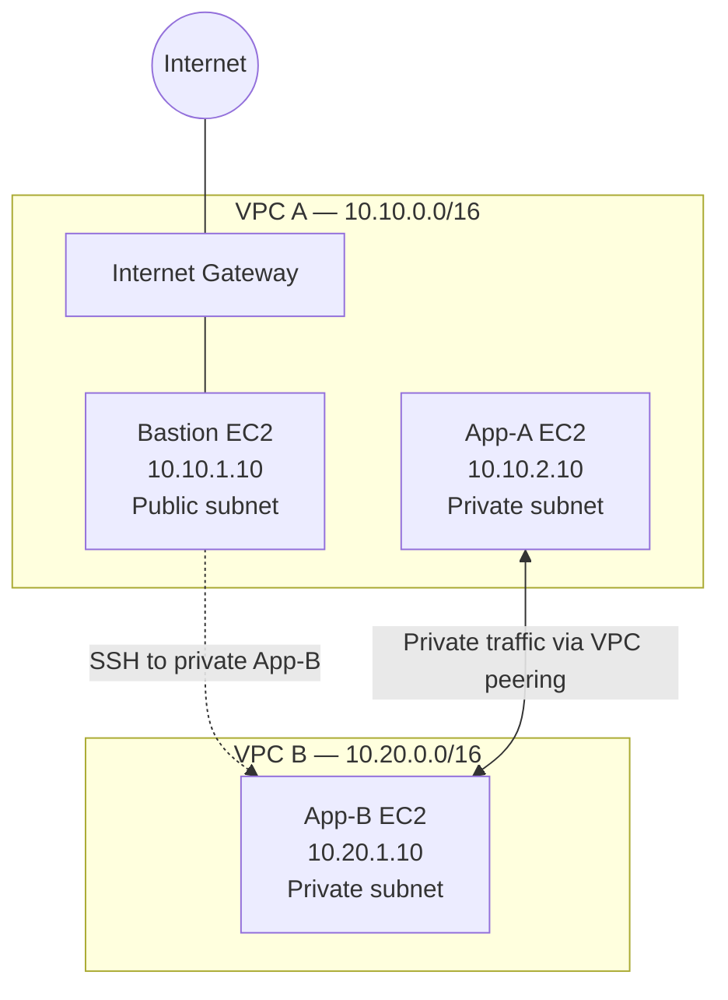
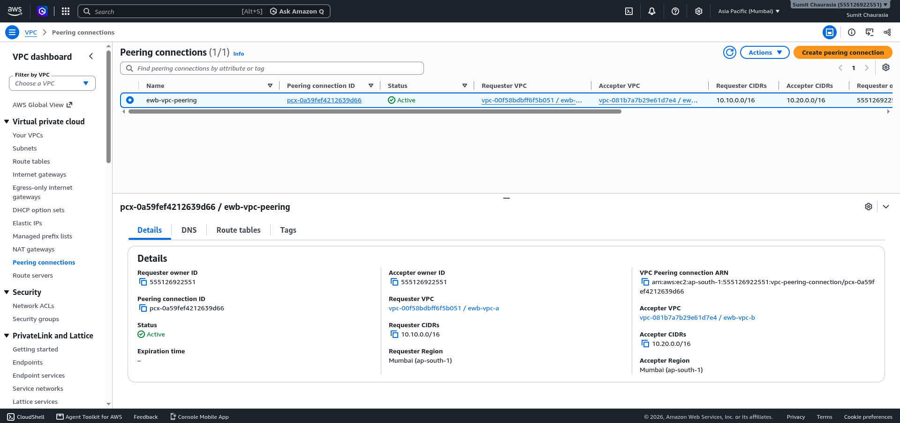
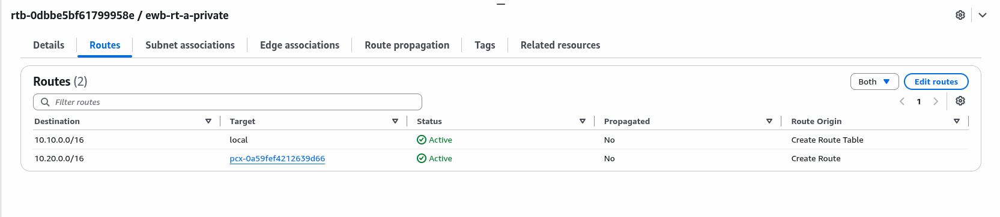
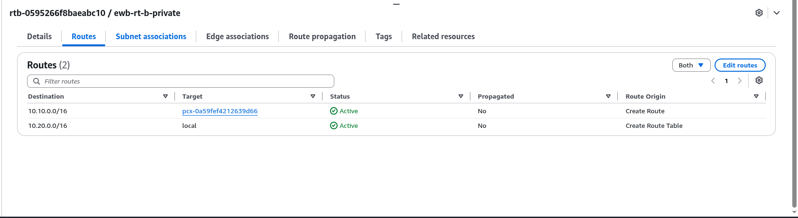
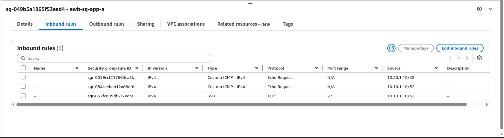
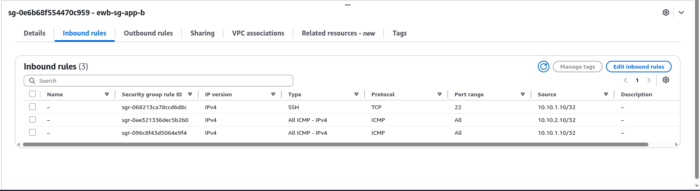
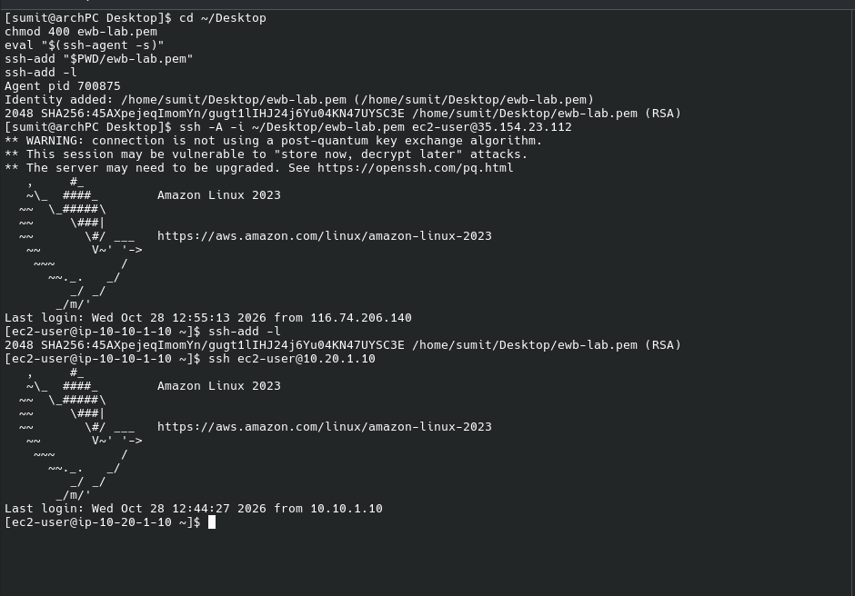
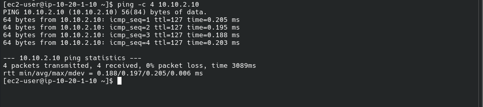

# AWS VPC Peering Lab

A hands-on AWS networking project demonstrating private communication between two Amazon Virtual Private Clouds (VPCs) using a VPC Peering Connection.


## Table of Contents

- [Project Overview](#project-overview)
- [Architecture](#architecture)
- [Network Configuration](#network-configuration)
- [Routing](#routing)
- [Security Configuration](#security-configuration)
- [Implementation and Testing](#implementation-and-testing)
- [Screenshots and Evidence](#screenshots-and-evidence)
- [Key Learnings](#key-learnings)
- [Cleanup](#cleanup)

## Project Overview

The objective is to connect two separate VPCs without assigning public IP addresses to the application instances. A bastion host in VPC A provides an SSH entry point to the private environment.

The VPCs communicate through an active VPC Peering Connection, with explicit routes in each VPC's private route table.

### Objectives

- Create two VPCs with non-overlapping CIDR ranges.
- Configure public and private subnets.
- Configure an Internet Gateway for the bastion's public subnet.
- Establish VPC peering between VPC A and VPC B.
- Configure routes for private cross-VPC communication.
- Apply security group rules for SSH and ICMP testing.
- Validate connectivity between private EC2 instances.

## Architecture



The diagram is a logical overview. Cross-VPC traffic requires both appropriate route-table entries and security group rules.

## Network Configuration

| Resource | CIDR / Private IP | Purpose |
|---|---|---|
| VPC A | `10.10.0.0/16` | Bastion and App-A network |
| VPC A public subnet | `10.10.1.0/24` | Bastion host |
| VPC A private subnet | `10.10.2.0/24` | App-A |
| Bastion | `10.10.1.10` | SSH entry point |
| App-A | `10.10.2.10` | Private application host |
| VPC B | `10.20.0.0/16` | App-B network |
| VPC B private subnet | `10.20.1.0/24` | App-B |
| App-B | `10.20.1.10` | Private application host |

The VPC CIDR ranges do not overlap, allowing the peering connection to route traffic between them.

## Routing

The following routes are required in addition to each VPC's automatically created local route.

| Route table | Destination | Target |
|---|---|---|
| VPC A private route table | `10.20.0.0/16` | VPC Peering Connection |
| VPC B private route table | `10.10.0.0/16` | VPC Peering Connection |
| VPC A public route table | `0.0.0.0/0` | VPC A Internet Gateway |

The public route is for the bastion's public subnet. The private subnets use the peering connection for traffic destined for the other VPC.

## Security Configuration

Security groups control traffic allowed to reach each EC2 instance.

| Security group | Intended inbound access |
|---|---|
| `ewb-sg-bastion` | SSH (TCP 22) from the authorized administrator's public IP |
| `ewb-sg-app-a` | SSH from the bastion (`10.10.1.10/32`); ICMP Echo Request from App-B (`10.20.1.10/32`) |
| `ewb-sg-app-b` | SSH from the bastion (`10.10.1.10/32`); ICMP Echo Request from App-A (`10.10.2.10/32`) |

Review the AWS console configuration when reproducing this lab. Security group rules should be limited to the sources and protocols required for the exercise.

## Implementation and Testing

1. Create VPC A and VPC B using the CIDR ranges documented above.
2. Create the public and private subnets and configure their route-table associations.
3. Attach an Internet Gateway to VPC A and configure the public route.
4. Launch the bastion in VPC A's public subnet.
5. Launch App-A and App-B in their respective private subnets without public IP addresses.
6. Create and accept the VPC Peering Connection.
7. Add reciprocal routes to the private route tables.
8. Configure the security groups for SSH and ICMP.
9. Connect to the bastion, then SSH to App-B using its private IP.
10. Test ICMP connectivity between App-A and App-B.

### Validation Results

The lab session recorded the following successful checks:

- SSH from the administrator's machine to the bastion.
- SSH from the bastion to App-B (`10.20.1.10`).
- Ping from App-B to App-A (`10.10.2.10`), with four replies and 0% packet loss.

These results demonstrate working private connectivity for the tested paths. They do not imply that every protocol or direction is automatically permitted.

## Screenshots and Evidence

The screenshots below document the configuration and test results captured during the lab.

### 1. VPC Peering Connection



### 2. VPC A Private Route Table



### 3. VPC B Private Route Table



### 4. App-A Security Group



### 5. App-B Security Group



### 6. SSH from Bastion to App-B



### 7. Cross-VPC Connectivity Test



## Key Learnings

- VPC peering provides private IP connectivity between VPCs.
- Peering does not automatically create routes in route tables.
- Security groups and route tables perform different roles and both must allow the intended traffic.
- A bastion host can provide controlled SSH access to private instances.
- Private EC2 instances can communicate without public IP addresses when networking and security rules are correctly configured.

## Security Notes

- Never commit `.pem` files, private keys, AWS credentials, or secrets.
- Keep SSH access restricted to authorized sources.
- Do not expose SSH to `0.0.0.0/0` for convenience.
- Treat account-specific resource IDs and public IP addresses as environment-specific.
- The `.gitignore` file excludes common private key and credential files.

## Cleanup

When the lab is no longer needed:

1. Terminate the EC2 instances.
2. Delete the VPC Peering Connection.
3. Detach and delete the Internet Gateway.
4. Delete the custom route tables and subnets.
5. Delete the security groups after their dependencies are removed.
6. Delete the VPCs.
7. Check the AWS Billing console for any remaining billable resources.

Deleting resources is irreversible. Verify the selected resources before removal.

## Repository Structure

```text
aws-vpc-peering-lab/
├── README.md
├── .gitignore
├── docs/
│   ├── architecture.md
│   ├── implementation-guide.md
│   └── testing-and-troubleshooting.md
└── screenshots/
    ├── 01-vpc-peering.png
    ├── 02-vpc-a-private-routes.png
    ├── 03-vpc-b-private-routes.png
    ├── 04-app-a-security-group.png
    ├── 05-app-b-security-group.png
    ├── 06-ssh-bastion-to-app-b.png
    └── 07-connectivity-test.png
```

---

**Project:** AWS VPC Peering Lab  
**Focus:** Cloud networking, routing, security groups, and private EC2 connectivity.
